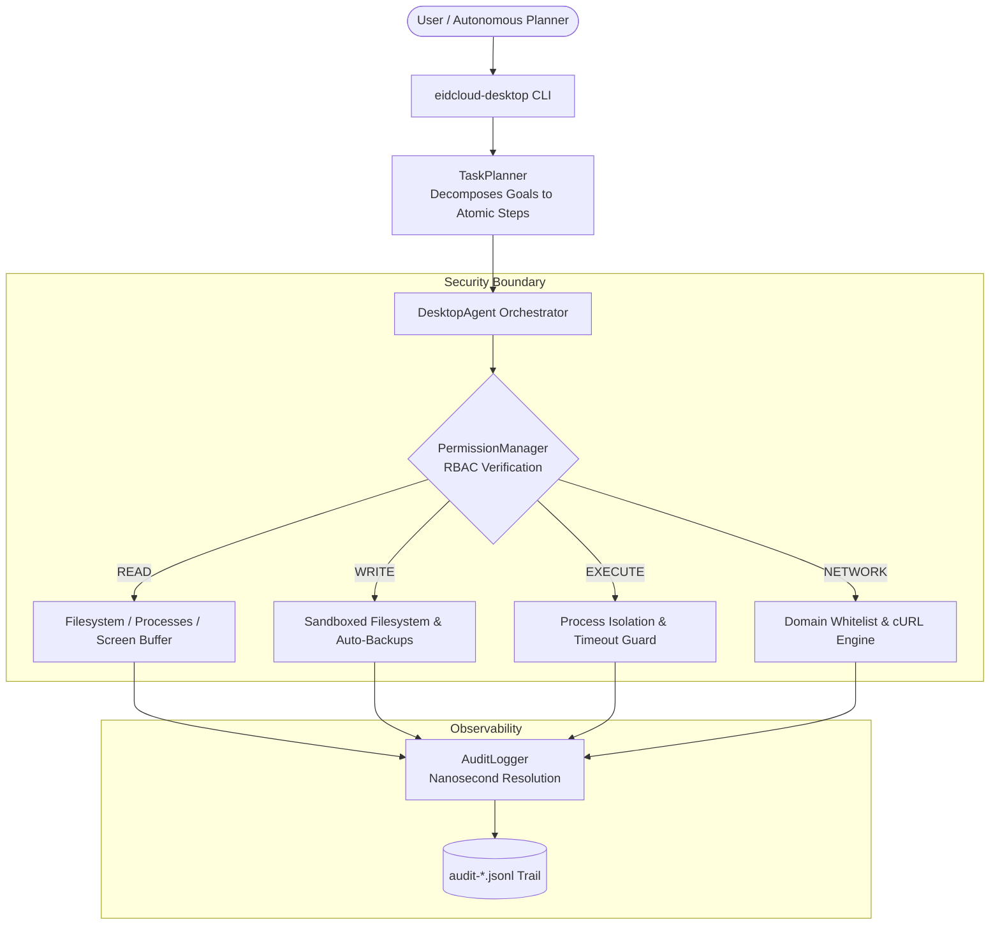

[🇸🇦 العربية](README.ar.md) | [🇬🇧 English](README.md)

# 🖥️ eidcloud-desktop-agent

> Sandboxed local computer and OS automation agent with strict permission tiers and high-velocity audit trail in pure PHP 8.2+.

[](https://github.com/eidcloud/eidcloud-desktop-agent/releases)
[](https://www.php.net/)
[](LICENSE)
[](https://colab.research.google.com/github/eidcloud/eidcloud-desktop-agent/blob/main/notebooks/quickstart.ipynb)

---

## 🌟 Overview

**eidcloud-desktop-agent** is an enterprise-grade, zero-dependency PHP 8.2+ agent designed to safely control, automate, and orchestrate desktop and server environments. By enforcing kernel-level and workspace path containment, comprehensive Role-Based Access Control (RBAC), and nanosecond-precision JSONL audit trails, it guarantees complete isolation and full forensic reproducibility for autonomous OS workflows.

---

## 🏗️ Architecture & Security Model



---

## 🛡️ RBAC Permission Tiers

Every operation initiated by the agent must pass through the `PermissionManager`:

| Permission Tier | Description | Protections & Constraints |
|:---|:---|:---|
| **`READ`** | Inspect filesystem, list processes, view screen buffer metadata | Strictly confined to sandbox paths; system inspection sanitized. |
| **`WRITE`** | Create, modify, move, or delete files | Directory traversal containment, automatic atomic file backups before mutation, unified unified diff generation. |
| **`EXECUTE`** | Run shell commands and system tools | Executable binary allowlist (`php`, `git`, `dir`, `ls`, etc.), execution time limits, non-blocking stream capture. |
| **`NETWORK`** | Outbound HTTP/HTTPS requests | Domain allowlisting, SSL verification, strict payload auditing. |

---

## 🚀 Key Capabilities

- **Zero Vendor Dependencies:** Standard PHP 8.2+ built-in primitives only. No third-party composer dependencies required.
- **Path Containment:** Absolute resolution and normalization prevents directory traversal attacks (`../`, symlinks).
- **Automated Reversible Backups:** Any modified or deleted file is instantaneously preserved in `.agent_backups` with a timestamped snapshot.
- **Nanosecond Audit Trail:** Every single file read, write, process spawn, and HTTP request is timestamped via `hrtime` and recorded with full input, output, and diff metadata.
- **Natural Language Task Decomposition:** Breaks high-level tasks (e.g. *"Organize downloads folder by filetype and compress archives"*) into verified atomic steps.
- **Interactive & Headless Modes:** Run autonomously in unattended pipelines or with interactive operator confirmation prompts.

---

## 📦 Installation

Clone the repository and verify system compatibility:

```bash
git clone https://github.com/eidcloud/eidcloud-desktop-agent.git
cd eidcloud-desktop-agent
php -v # Requires PHP 8.2 or later
```

No `composer install` is necessary, but standard PSR-4 autoloading is provided out-of-the-box.

---

## 💻 CLI Usage

The agent ships with a self-contained CLI executable at `bin/eidcloud-desktop`:

### 1. Run an Automated Task
Execute a task within a specified workspace:
```bash
php bin/eidcloud-desktop run --task="Organize directory ./tmp by extension" --sandbox=./tmp
```

Run with interactive human-in-the-loop authorization:
```bash
php bin/eidcloud-desktop run --task="Organize directory ./tmp by extension" --sandbox=./tmp --interactive
```

### 2. Inspect Audit Log
Inspect the nanosecond audit trail of the latest or a specific session:
```bash
# View latest session
php bin/eidcloud-desktop audit-log --session=latest --sandbox=./tmp

# View specific session
php bin/eidcloud-desktop audit-log --session=c5999dda7fb46dcb --sandbox=./tmp
```

### 3. Dry-Run / Plan Inspection
Preview the atomic steps the agent will generate without executing them:
```bash
php bin/eidcloud-desktop plan --task="Clean temporary files in ./data" --sandbox=./data
```

### 4. Inspect Environment & Status
```bash
php bin/eidcloud-desktop status --sandbox=./tmp
```

---

## 🧪 Testing

The repository includes a standalone automated test suite with 100% assertions pass rate:

```bash
php tests/run_tests.php
```

Sample output:
```text
🧪 Running EidCloud Desktop Agent Test Suite (PHP 8.2.12)...
──────────────────────────────────────────────────────────────────────
  ▶ testRbacEnforcement... PASSED (2.51ms)
  ▶ testSandboxPathContainment... PASSED (2.35ms)
  ▶ testFileOperationsWithDiffAndBackup... PASSED (13.81ms)
  ▶ testCommandExecutionAndWhitelist... PASSED (428.61ms)
  ▶ testInteractiveModeRejection... PASSED (0.42ms)
  ▶ testTaskPlannerAndExecution... PASSED (27.02ms)
  ▶ testHighVelocityAuditTrail... PASSED (2.69ms)
──────────────────────────────────────────────────────────────────────
✨ All 7 tests passed successfully! (100% PASS)
```

---

## 📓 Interactive Google Colab Notebook

Get started in seconds directly in your browser without installing anything locally:

[](https://colab.research.google.com/github/eidcloud/eidcloud-desktop-agent/blob/main/notebooks/quickstart.ipynb)

The quickstart notebook demonstrates:
1. Environment initialization and sandbox workspace setup.
2. Executing an automated file organization task.
3. Live streaming and formatting of the nanosecond audit log.

---

## 👤 Author & Maintainer

**Eng. MHD. Shadi AL-Hasan**  
- **Role:** Executive CTO & Enterprise Solutions Architect  
- **Email:** [mhd.shadi.alhasan@gmail.com](mailto:mhd.shadi.alhasan@gmail.com)  
- **Phone / WhatsApp:** [+963934005922](tel:+963934005922)  
- **Location:** Damascus, Syria  
- **GitHub:** [shadialhasan](https://github.com/shadialhasan)  

---

## 📄 License

This project is licensed under the MIT License - see the [LICENSE](LICENSE) file for details.  
Copyright (c) 2026 **MHD. Shadi AL-Hasan**. All rights reserved.
